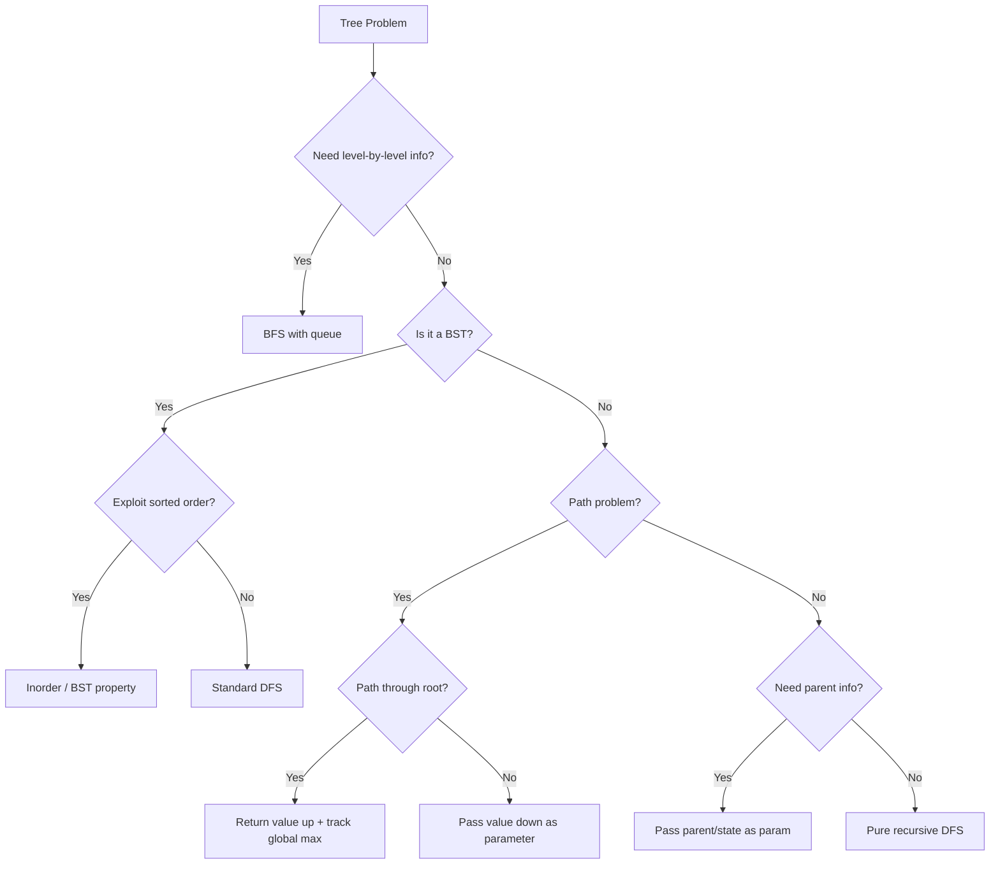

# Trees — Pattern Notes

## Core Intuition

Trees are recursive structures. Almost every tree problem reduces to: **what do I need from my children to answer the question at the current node?** Define that return value clearly, then trust recursion.

- **DFS** = process node + recurse. Choose pre/in/post based on when you need the node's value relative to children.
- **BFS** = level-by-level using a queue. Use when you need level info or shortest path.
- **BST** = left < node < right. Inorder traversal gives sorted order. Always exploit this property.

---

## Decision Flowchart

---

## Per-Problem Notes

### 1. Inorder Traversal — LC 94 | Easy
- **Key insight:** Left → Node → Right. Iterative uses explicit stack; push left spine, pop, go right.
- **Tricky:** Iterative version — remember to move `curr = curr.right` after popping.
- **Common mistakes:** Forgetting the right subtree in iterative; confusing with preorder.
- **Time:** O(n) | **Space:** O(h) stack

### 2. Preorder Traversal — LC 144 | Easy
- **Key insight:** Node → Left → Right. Iterative: push right then left so left is processed first.
- **Tricky:** Iterative push order is reversed (right before left).
- **Common mistakes:** Pushing left before right in iterative.
- **Time:** O(n) | **Space:** O(h)

### 3. Postorder Traversal — LC 145 | Easy
- **Key insight:** Left → Right → Node. Iterative trick: reverse of modified preorder (Node→Right→Left).
- **Tricky:** Iterative is non-obvious; use two-stack or reverse trick.
- **Common mistakes:** Trying to directly simulate postorder iteratively without the reverse trick.
- **Time:** O(n) | **Space:** O(h)

### 4. Invert Binary Tree — LC 226 | Easy
- **Key insight:** Swap left and right children at every node. Pure recursion.
- **Tricky:** Nothing — classic recursion warm-up.
- **Common mistakes:** Forgetting to return the node after swapping.
- **Time:** O(n) | **Space:** O(h)

### 5. Maximum Depth — LC 104 | Easy
- **Key insight:** `max(depth(left), depth(right)) + 1`. Base case: null → 0.
- **Tricky:** Off-by-one — depth of a single node is 1, not 0.
- **Common mistakes:** Returning 0 for leaf instead of 1.
- **Time:** O(n) | **Space:** O(h)

### 6. Diameter of Binary Tree — LC 543 | Easy
- **Key insight:** Diameter through a node = left_height + right_height. Track global max, return height upward.
- **Tricky:** The diameter doesn't have to pass through root. Must use a nonlocal/global variable.
- **Common mistakes:** Returning diameter instead of height from the recursive function.
- **Time:** O(n) | **Space:** O(h)

### 7. Balanced Binary Tree — LC 110 | Easy
- **Key insight:** Return -1 as a sentinel for "unbalanced" up the call stack. Avoids recomputation.
- **Tricky:** Naïve O(n²) solution recomputes heights. Optimal does it in one pass.
- **Common mistakes:** Computing height separately for each node (O(n²)).
- **Time:** O(n) | **Space:** O(h)

### 8. Same Tree — LC 100 | Easy
- **Key insight:** Two trees are same if roots equal AND left subtrees same AND right subtrees same.
- **Tricky:** Handle null cases: both null → true, one null → false.
- **Common mistakes:** Not handling the case where one is null and other isn't.
- **Time:** O(n) | **Space:** O(h)

### 9. Subtree of Another Tree — LC 572 | Easy
- **Key insight:** At each node of the big tree, check if `isSameTree(node, subRoot)`. Recurse if not.
- **Tricky:** O(n·m) is acceptable here. Serialization approach is O(n+m) but complex.
- **Common mistakes:** Not checking the current node itself, only children.
- **Time:** O(n·m) | **Space:** O(h)

### 10. LCA of BST — LC 235 | Medium
- **Key insight:** If both nodes < root → go left. Both > root → go right. Otherwise root is LCA.
- **Tricky:** BST property makes this O(h) instead of O(n).
- **Common mistakes:** Using the general LCA approach (LC 236) which ignores BST property.
- **Time:** O(h) | **Space:** O(h)

### 11. Insert into BST — LC 701 | Medium
- **Key insight:** Recurse left/right based on comparison. Insert at the null spot.
- **Tricky:** Return the node at each step to reattach it to parent.
- **Common mistakes:** Not returning the node — breaks the tree linkage.
- **Time:** O(h) | **Space:** O(h)

### 12. Delete Node in BST — LC 450 | Medium
- **Key insight:** Three cases: no children (delete), one child (replace), two children (replace with inorder successor = leftmost of right subtree).
- **Tricky:** Two-children case. Find inorder successor, copy its value, delete successor from right subtree.
- **Common mistakes:** Forgetting to recursively delete the successor after copying its value.
- **Time:** O(h) | **Space:** O(h)

### 13. Binary Tree Level Order — LC 102 | Medium
- **Key insight:** BFS with queue. Track level size at start of each iteration.
- **Tricky:** Snapshot `len(queue)` before the inner loop, not during.
- **Common mistakes:** Not snapshotting queue size — processes multiple levels in one pass.
- **Time:** O(n) | **Space:** O(n)

### 14. Right Side View — LC 199 | Medium
- **Key insight:** BFS level order — take the last element of each level. Or DFS passing depth, update result when depth == len(result).
- **Tricky:** DFS approach: visit right child first so rightmost is seen first at each depth.
- **Common mistakes:** BFS: taking first element instead of last.
- **Time:** O(n) | **Space:** O(n)

### 15. Construct Quad Tree — LC 427 | Medium
- **Key insight:** Check if all values in region are same → leaf. Otherwise split into 4 quadrants recursively.
- **Tricky:** Precompute 2D prefix sums to check uniformity in O(1) per region.
- **Common mistakes:** Recomputing sum naively → O(n² log n). Use prefix sums for O(n²).
- **Time:** O(n²) | **Space:** O(n²)

### 16. Count Good Nodes — LC 1448 | Medium
- **Key insight:** Pass max value seen so far down the tree. Node is "good" if its value ≥ max.
- **Tricky:** Pass max as parameter (top-down), not bottom-up.
- **Common mistakes:** Trying to solve bottom-up when top-down is natural here.
- **Time:** O(n) | **Space:** O(h)

### 17. Validate BST — LC 98 | Medium
- **Key insight:** Pass (min, max) bounds down. Each node must satisfy min < node.val < max.
- **Tricky:** Initial bounds are (-∞, +∞). Use `float('-inf')` and `float('inf')`.
- **Common mistakes:** Only comparing with direct parent (fails for grandparent violations). Duplicate values — BST typically requires strict inequality.
- **Time:** O(n) | **Space:** O(h)

### 18. Kth Smallest in BST — LC 230 | Medium
- **Key insight:** Inorder traversal of BST gives sorted order. Stop at kth element.
- **Tricky:** Iterative inorder with early exit is more efficient than collecting all.
- **Common mistakes:** Collecting entire inorder list then indexing — wastes memory.
- **Time:** O(h + k) | **Space:** O(h)

### 19. Construct Tree from Preorder+Inorder — LC 105 | Medium
- **Key insight:** Preorder[0] is root. Find root in inorder → splits into left/right subtrees. Recurse.
- **Tricky:** Use a hashmap for O(1) inorder index lookup. Track preorder index with nonlocal/pointer.
- **Common mistakes:** Linear search in inorder (O(n²)). Off-by-one in index slicing.
- **Time:** O(n) | **Space:** O(n)

### 20. House Robber III — LC 337 | Medium
- **Key insight:** At each node, return (rob_this, skip_this). rob_this = node.val + skip_left + skip_right. skip_this = max(rob_left, skip_left) + max(rob_right, skip_right).
- **Tricky:** Return a pair from each recursive call to avoid recomputation.
- **Common mistakes:** Using memoization with a dict — works but the pair-return approach is cleaner and O(n).
- **Time:** O(n) | **Space:** O(h)

### 21. Delete Leaves with Given Value — LC 1325 | Medium
- **Key insight:** Postorder — process children first, then check if current node became a leaf with target value.
- **Tricky:** After deleting children, the parent might now be a leaf with target value too.
- **Common mistakes:** Preorder traversal — misses nodes that become leaves after children are deleted.
- **Time:** O(n) | **Space:** O(h)

### 22. Binary Tree Maximum Path Sum — LC 124 | Hard
- **Key insight:** At each node, max gain = node.val + max(0, left_gain) + max(0, right_gain) for the global answer. But return only node.val + max(0, max(left, right)) upward (can't split).
- **Tricky:** The path through a node can't branch when returned to parent. Two different computations: one for global max, one for return value.
- **Common mistakes:** Returning the full path sum (with both children) to parent — invalid since a path can't fork.
- **Time:** O(n) | **Space:** O(h)

### 23. Serialize/Deserialize Binary Tree — LC 297 | Hard
- **Key insight:** Preorder with null markers. Serialize: "1,2,N,N,3,N,N". Deserialize: use a queue/iterator of tokens.
- **Tricky:** Deserialize needs a mutable index/iterator. Use `collections.deque` and `popleft()`.
- **Common mistakes:** Using a list index without making it mutable (nonlocal or iterator). Forgetting null markers.
- **Time:** O(n) | **Space:** O(n)

---

## Edge Cases to Watch For

- **Null/empty tree:** Always handle `if not root: return ...` first.
- **Single node tree:** Diameter = 0, depth = 1, it's both a leaf and root.
- **Skewed trees:** Stack overflow risk in deep recursion. Height = n for a linked-list tree.
- **BST with duplicates:** Clarify if duplicates are allowed and which side they go.
- **Negative values:** Max path sum — don't assume all values are positive. Use `max(0, gain)` to ignore negative branches.
- **Path problems:** "Path" usually means no revisiting nodes. Clarify if it must go root-to-leaf or any node-to-node.
- **Integer overflow:** Max path sum with large values — use Python (no overflow) or long in Java/C++.
