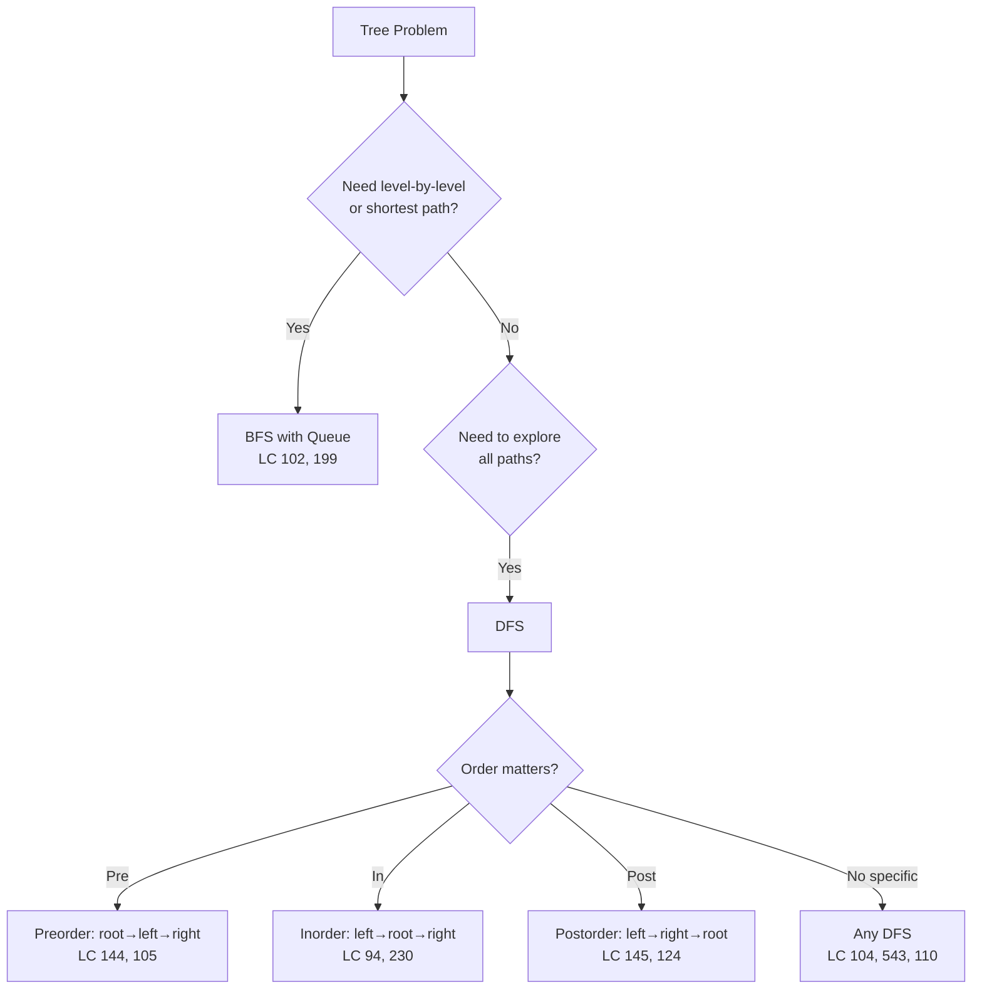
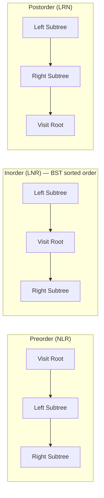
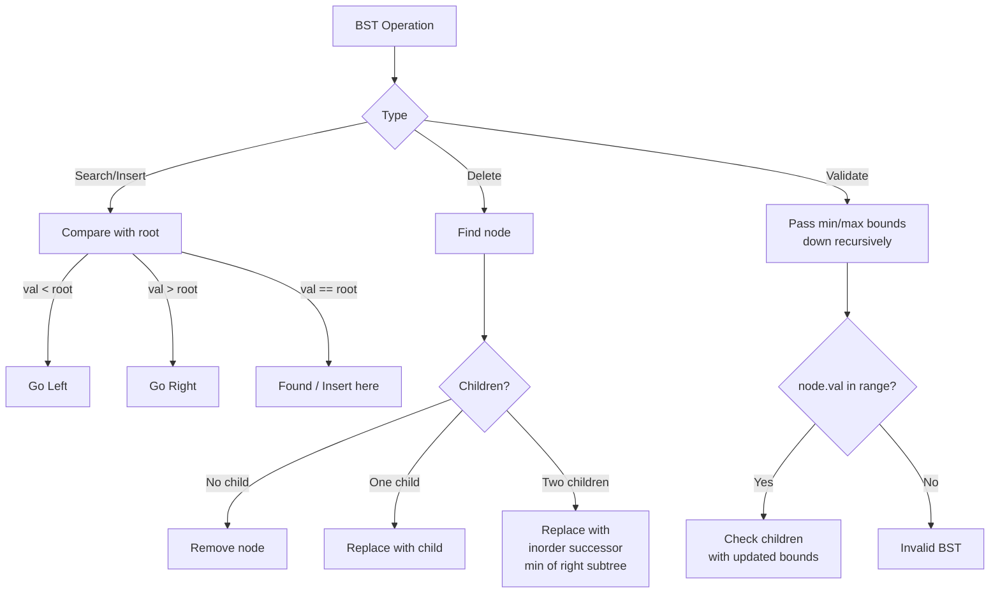
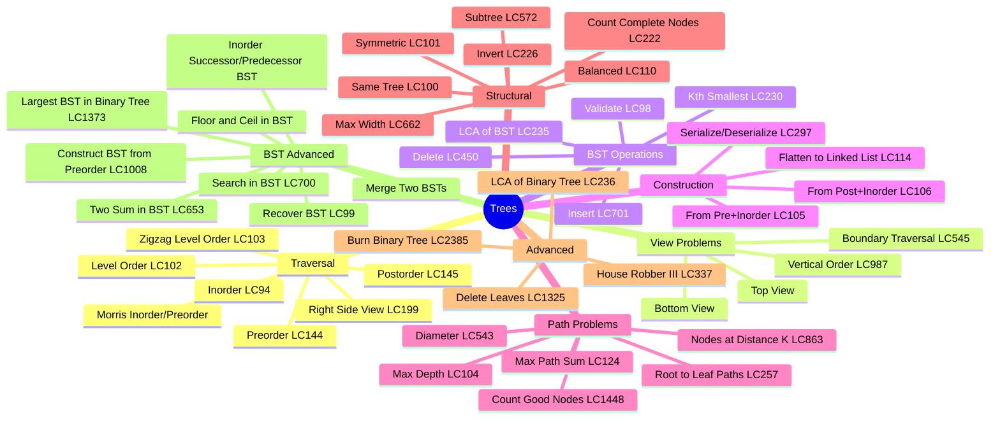
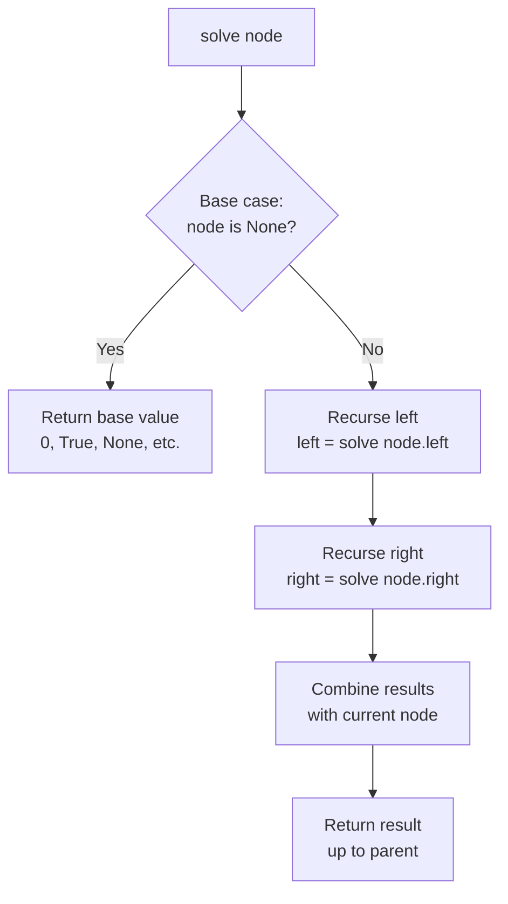

# Trees

## Problem List

| # | Problem | LC | Difficulty |
|---|---------|-----|------------|
| 1 | Binary Tree Inorder Traversal | [94](https://leetcode.com/problems/binary-tree-inorder-traversal/) | 🟢 Easy |
| 2 | Binary Tree Preorder Traversal | [144](https://leetcode.com/problems/binary-tree-preorder-traversal/) | 🟢 Easy |
| 3 | Binary Tree Postorder Traversal | [145](https://leetcode.com/problems/binary-tree-postorder-traversal/) | 🟢 Easy |
| 4 | Invert Binary Tree | [226](https://leetcode.com/problems/invert-binary-tree/) | 🟢 Easy |
| 5 | Maximum Depth of Binary Tree | [104](https://leetcode.com/problems/maximum-depth-of-binary-tree/) | 🟢 Easy |
| 6 | Diameter of Binary Tree | [543](https://leetcode.com/problems/diameter-of-binary-tree/) | 🟢 Easy |
| 7 | Balanced Binary Tree | [110](https://leetcode.com/problems/balanced-binary-tree/) | 🟢 Easy |
| 8 | Same Tree | [100](https://leetcode.com/problems/same-tree/) | 🟢 Easy |
| 9 | Subtree of Another Tree | [572](https://leetcode.com/problems/subtree-of-another-tree/) | 🟢 Easy |
| 10 | Lowest Common Ancestor of BST | [235](https://leetcode.com/problems/lowest-common-ancestor-of-a-binary-search-tree/) | 🟡 Medium |
| 11 | Insert into BST | [701](https://leetcode.com/problems/insert-into-a-binary-search-tree/) | 🟡 Medium |
| 12 | Delete Node in BST | [450](https://leetcode.com/problems/delete-node-in-a-bst/) | 🟡 Medium |
| 13 | Binary Tree Level Order Traversal | [102](https://leetcode.com/problems/binary-tree-level-order-traversal/) | 🟡 Medium |
| 14 | Binary Tree Right Side View | [199](https://leetcode.com/problems/binary-tree-right-side-view/) | 🟡 Medium |
| 15 | Construct Quad Tree | [427](https://leetcode.com/problems/construct-quad-tree/) | 🟡 Medium |
| 16 | Count Good Nodes | [1448](https://leetcode.com/problems/count-good-nodes-in-binary-tree/) | 🟡 Medium |
| 17 | Validate BST | [98](https://leetcode.com/problems/validate-binary-search-tree/) | 🟡 Medium |
| 18 | Kth Smallest Element in BST | [230](https://leetcode.com/problems/kth-smallest-element-in-a-bst/) | 🟡 Medium |
| 19 | Construct Tree from Preorder and Inorder | [105](https://leetcode.com/problems/construct-binary-tree-from-preorder-and-inorder-traversal/) | 🟡 Medium |
| 20 | House Robber III | [337](https://leetcode.com/problems/house-robber-iii/) | 🟡 Medium |
| 21 | Delete Leaves With Given Value | [1325](https://leetcode.com/problems/delete-leaves-with-a-given-value/) | 🟡 Medium |
| 22 | Binary Tree Maximum Path Sum | [124](https://leetcode.com/problems/binary-tree-maximum-path-sum/) | 🔴 Hard |
| 23 | Serialize And Deserialize Binary Tree | [297](https://leetcode.com/problems/serialize-and-deserialize-binary-tree/) | 🔴 Hard |
| 24 | Zigzag Level Order Traversal | [103](https://leetcode.com/problems/binary-tree-zigzag-level-order-traversal/) | 🟡 Medium |
| 25 | Boundary Traversal | [545](https://leetcode.com/problems/boundary-of-binary-tree/) | 🟡 Medium |
| 26 | Vertical Order Traversal | [987](https://leetcode.com/problems/vertical-order-traversal-of-a-binary-tree/) | 🔴 Hard |
| 27 | Top View of Binary Tree | — | 🟡 Medium |
| 28 | Bottom View of Binary Tree | — | 🟡 Medium |
| 29 | Symmetric Tree | [101](https://leetcode.com/problems/symmetric-tree/) | 🟢 Easy |
| 30 | Root to Leaf Paths | [257](https://leetcode.com/problems/binary-tree-paths/) | 🟢 Easy |
| 31 | Lowest Common Ancestor of Binary Tree | [236](https://leetcode.com/problems/lowest-common-ancestor-of-a-binary-tree/) | 🟡 Medium |
| 32 | Maximum Width of Binary Tree | [662](https://leetcode.com/problems/maximum-width-of-binary-tree/) | 🟡 Medium |
| 33 | All Nodes Distance K | [863](https://leetcode.com/problems/all-nodes-distance-k-in-binary-tree/) | 🟡 Medium |
| 34 | Burn Binary Tree | [2385](https://leetcode.com/problems/amount-of-time-for-binary-tree-to-be-infected/) | 🔴 Hard |
| 35 | Count Complete Tree Nodes | [222](https://leetcode.com/problems/count-complete-tree-nodes/) | 🟢 Easy |
| 36 | Construct BT from Postorder and Inorder | [106](https://leetcode.com/problems/construct-binary-tree-from-inorder-and-postorder-traversal/) | 🟡 Medium |
| 37 | Morris Traversal | — | 🟡 Medium |
| 38 | Flatten Binary Tree to Linked List | [114](https://leetcode.com/problems/flatten-binary-tree-to-linked-list/) | 🟡 Medium |
| 39 | Search in BST | [700](https://leetcode.com/problems/search-in-a-binary-search-tree/) | 🟢 Easy |
| 40 | Floor and Ceil in BST | — | 🟡 Medium |
| 41 | Construct BST from Preorder | [1008](https://leetcode.com/problems/construct-binary-search-tree-from-preorder-traversal/) | 🟡 Medium |
| 42 | Inorder Successor/Predecessor in BST | — | 🟡 Medium |
| 43 | Merge Two BSTs | — | 🟡 Medium |
| 44 | Two Sum in BST | [653](https://leetcode.com/problems/two-sum-iv-input-is-a-bst/) | 🟢 Easy |
| 45 | Recover BST | [99](https://leetcode.com/problems/recover-binary-search-tree/) | 🟡 Medium |
| 46 | Largest BST in Binary Tree | [1373](https://leetcode.com/problems/maximum-sum-bst-in-binary-tree/) | 🔴 Hard |

---

## Approach Diagrams

### DFS vs BFS Decision

### Tree Traversal Orders

### BST Operations Flow

### Problem Categories

### Recursive Tree Pattern Template

---

## Complexity Summary

| Problem | Time | Space | Pattern |
|---------|------|-------|---------|
| Inorder/Preorder/Postorder | O(n) | O(h) | DFS recursive/iterative |
| Level Order / Zigzag | O(n) | O(w) | BFS |
| Morris Traversal | O(n) | O(1) | Threading |
| Max Depth | O(n) | O(h) | DFS |
| Diameter | O(n) | O(h) | DFS, return height |
| Balanced | O(n) | O(h) | DFS, return height |
| Same Tree / Subtree | O(n·m) | O(h) | DFS |
| Symmetric Tree | O(n) | O(h) | DFS mirror compare |
| Invert Tree | O(n) | O(h) | DFS/BFS |
| BST Insert/Delete/Search | O(h) | O(h) | BST property |
| Validate BST | O(n) | O(h) | DFS + bounds |
| Kth Smallest | O(h+k) | O(h) | Inorder DFS |
| LCA of BST | O(h) | O(1) | BST split point |
| LCA of Binary Tree | O(n) | O(h) | DFS both sides |
| Floor/Ceil in BST | O(h) | O(1) | BST traversal |
| Construct from Pre+Inorder | O(n) | O(n) | Preorder + hashmap |
| Construct from Post+Inorder | O(n) | O(n) | Postorder + hashmap |
| Construct BST from Preorder | O(n) | O(h) | Recursive with bounds |
| Right Side View | O(n) | O(w) | BFS last per level |
| Boundary Traversal | O(n) | O(n) | 3-pass: left + leaves + right |
| Vertical Order | O(n log n) | O(n) | BFS + sort by col |
| Top/Bottom View | O(n) | O(n) | BFS + first/last per col |
| Count Good Nodes | O(n) | O(h) | DFS + max so far |
| Max Path Sum | O(n) | O(h) | DFS, global max |
| Max Width | O(n) | O(w) | BFS + position indexing |
| Serialize/Deserialize | O(n) | O(n) | BFS or DFS |
| Flatten to Linked List | O(n) | O(1) | Morris-like |
| Nodes at Distance K | O(n) | O(n) | Parent map + BFS |
| Burn Binary Tree | O(n) | O(n) | Parent map + BFS |
| Count Complete Tree Nodes | O(log²n) | O(log n) | Height comparison |
| House Robber III | O(n) | O(h) | DFS, return pair |
| Delete Leaves | O(n) | O(h) | Postorder DFS |
| Inorder Successor/Predecessor | O(h) | O(1) | BST traversal |
| Two Sum in BST | O(n) | O(n) | Inorder + two pointers |
| Recover BST | O(n) | O(1) | Morris + find violations |
| Merge Two BSTs | O(m+n) | O(m+n) | Inorder + merge + build |
| Largest BST Subtree | O(n) | O(h) | Post-order, return tuple |

> h = tree height (O(log n) balanced, O(n) worst), w = max width

---

## Study Order

```mermaid
flowchart LR
    subgraph W1["Week 1: Basic Traversals"]
        t1["inorder(94) → preorder(144) → postorder(145)"]
        t2["level_order(102) → zigzag(103) → right_side_view(199)"]
    end

    subgraph W2["Week 2: DFS Patterns"]
        t3["invert(226) → max_depth(104) → diameter(543)"]
        t4["balanced(110) → same_tree(100) → subtree(572) → symmetric(101) → count_good_nodes(1448)"]
    end

    subgraph W3["Week 3: View Problems"]
        t5["boundary_traversal → vertical_order(987)"]
        t6["top_view → bottom_view → morris_traversal"]
    end

    subgraph W4["Week 4: BST Operations"]
        t7["search(700) → insert(701) → delete(450) → validate(98)"]
        t8["kth_smallest(230) → lca_bst(235) → floor_ceil → inorder_successor_predecessor"]
        t9["two_sum_bst(653) → construct_bst_from_preorder(1008) → merge_two_bsts"]
    end

    subgraph W5["Week 5: Construction + Path Problems"]
        t10["construct_pre_inorder(105) → construct_post_inorder(106)"]
        t11["serialize_deserialize(297) → flatten(114) → count_complete_nodes(222)"]
        t12["root_to_leaf_paths(257) → lca_binary_tree(236) → max_width(662)"]
    end

    subgraph W6["Week 6: Hard + Advanced"]
        t13["max_path_sum(124) → burn_binary_tree(2385) → all_nodes_distance_k(863)"]
        t14["recover_bst(99) → largest_bst(333) → house_robber_iii(337)"]
        t15["delete_leaves(1325) → construct_quad_tree(427) → morris_traversal"]
    end

    W1 --> W2 --> W3 --> W4 --> W5 --> W6
```

**Key insight:** Master the recursive template first (base case → recurse left → recurse right → combine). Every tree problem is a variation of this pattern.
