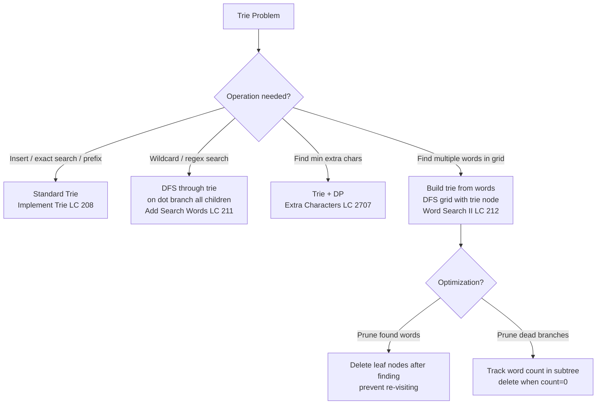

# Tries (Prefix Trees)

## Core Intuition
A trie stores strings character by character in a tree. Each node represents a prefix. Use when you need fast prefix lookups, autocomplete, or searching a dictionary of words.

- **TrieNode**: children map (dict or array[26]) + `is_end` flag
- **Insert**: Walk/create nodes for each character
- **Search**: Walk nodes; check `is_end` at last char
- **StartsWith**: Same as search but don't require `is_end`
- **Wildcard**: DFS with branching on '.' nodes
- **Trie + Backtracking**: Build trie from word list, then DFS grid

## Decision Flowchart

## Problems

### Implement Trie (Prefix Tree) — LC 208 | Medium
- **Learn**: TrieNode with `children: dict` and `is_end: bool`; implement insert, search, startsWith
- **Mistake**: Using a flat dict of full strings (defeats the purpose; doesn't support prefix queries efficiently)
- **Complexity**: O(m) per operation where m = word length; O(n·m) space total
- **Edge**: Empty string insert/search; searching prefix that is also a full word; duplicate inserts

---

### Add and Search Words — LC 211 | Medium
- **Learn**: Standard trie insert; search uses DFS — on '.', recurse into all children
- **Mistake**: Iterative search doesn't handle '.' cleanly; use recursive DFS
- **Complexity**: O(m) insert, O(26^m) worst-case search (all dots), O(n·m) space
- **Edge**: Pattern is all dots; pattern longer than any inserted word; empty pattern

---

### Extra Characters in a String — LC 2707 | Medium
- **Learn**: Build trie from dictionary; dp[i] = min extra chars in s[0..i-1]; at each i, try all substrings s[j..i-1] in trie
- **Mistake**: Using set lookup instead of trie (both work, but trie is the intended pattern); not initializing dp[0]=0
- **Complexity**: O(n²) time with trie traversal, O(n + d·m) space where d=dict size, m=avg word length
- **Edge**: No dictionary words match → return len(s); entire string is one dictionary word → 0

---

### Word Search II — LC 212 | Hard
- **Learn**: Build trie from `words`; DFS from each grid cell tracking current trie node; add word when `node.word` is set
- **Mistake**: Running separate Word Search I for each word (O(words × m×n × 4^L)); trie shares prefixes
- **Optimization**: After finding a word, set `node.word = None` to avoid duplicates; prune trie nodes with no children
- **Complexity**: O(m·n·4·3^(L-1)) time where L=max word length, O(total chars in words) space
- **Edge**: Duplicate words in input (deduplicate or use `node.word=None` trick); single cell grid; word not in grid

---

## General Edge Cases
- Empty string operations
- Words with common prefixes (core trie use case — should work correctly)
- Very long words vs short words in same trie
- Duplicate words in word list (Word Search II)
- Grid with all same characters
- Dictionary word that is a prefix of another dictionary word
- Case sensitivity (problems typically lowercase only)
