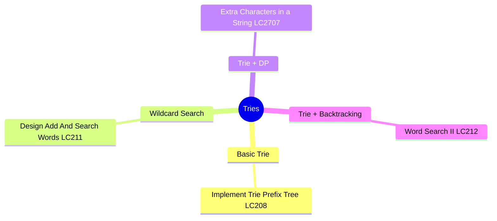
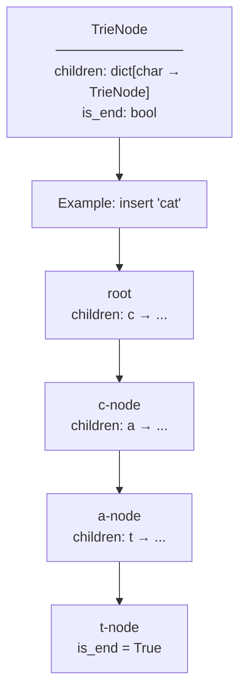
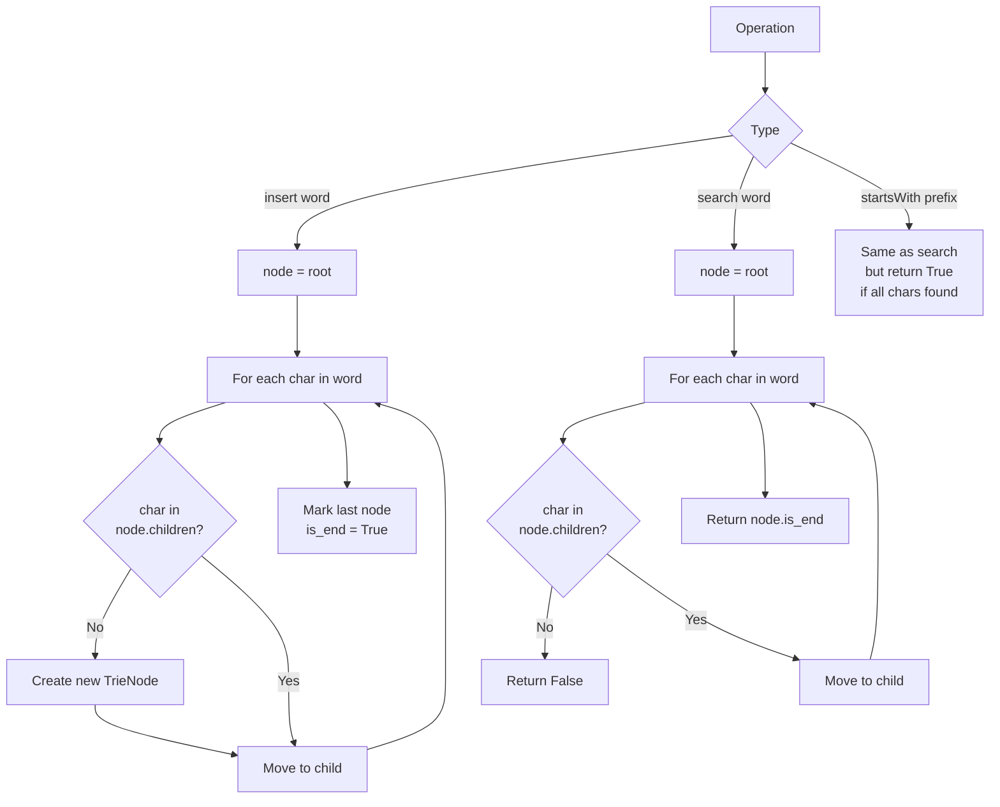
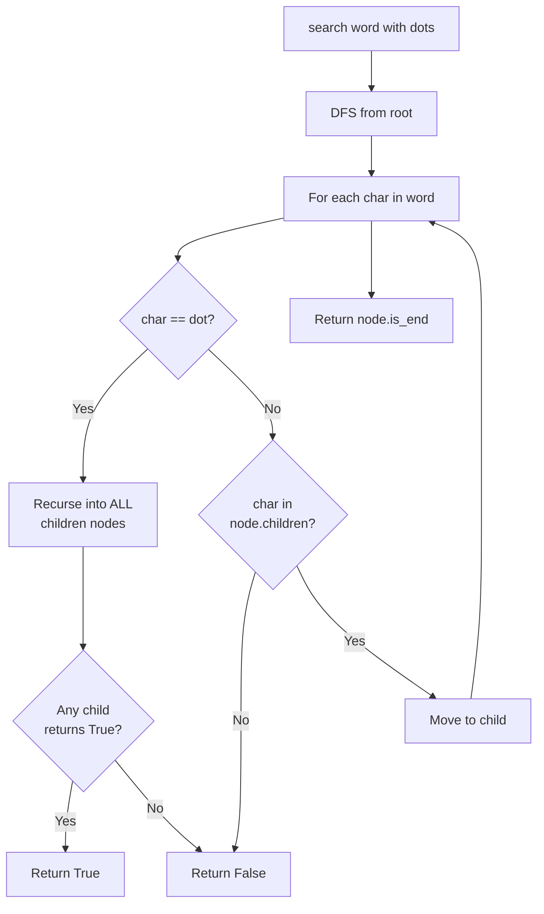
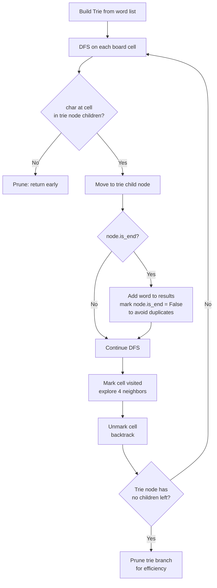
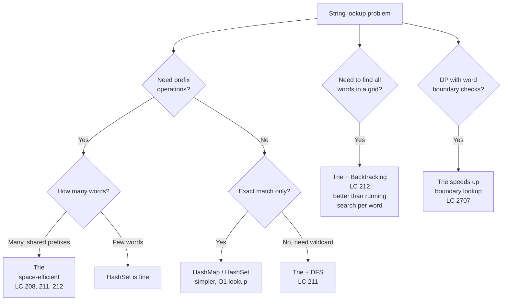
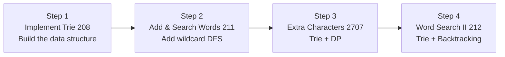

# Tries

## Problem List

| # | Problem | LC | Difficulty |
|---|---------|-----|------------|
| 1 | Implement Trie Prefix Tree | [208](https://leetcode.com/problems/implement-trie-prefix-tree/) | 🟡 Medium |
| 2 | Design Add And Search Words | [211](https://leetcode.com/problems/design-add-and-search-words-data-structure/) | 🟡 Medium |
| 3 | Extra Characters in a String | [2707](https://leetcode.com/problems/extra-characters-in-a-string/) | 🟡 Medium |
| 4 | Word Search II | [212](https://leetcode.com/problems/word-search-ii/) | 🔴 Hard |

---

## Approach Diagrams

### Trie Node Structure

### Insert / Search / StartsWith Operations

### Wildcard Search with DFS — LC 211

### Trie + Backtracking — Word Search II (LC 212)

### When to Use Trie vs HashMap

---

## Complexity Summary

| Problem | Time | Space | Notes |
|---------|------|-------|-------|
| Insert (208) | O(L) | O(L) | L = word length |
| Search (208) | O(L) | O(1) | |
| StartsWith (208) | O(L) | O(1) | |
| Add & Search (211) | O(L) insert, O(26^L) search worst | O(total chars) | Dot triggers full DFS |
| Extra Characters (2707) | O(n² · L) | O(total chars) | DP + trie lookup |
| Word Search II (212) | O(m·n · 4^L) | O(total chars) | Trie prunes repeated searches |

> L = average word length, m·n = board size

---

## Study Order

**Key insight:** A Trie is just a tree where each edge is a character. Its power is shared prefixes — instead of storing "cat", "car", "card" three times, they share the "ca" path. Always implement LC 208 from scratch before attempting the others.
