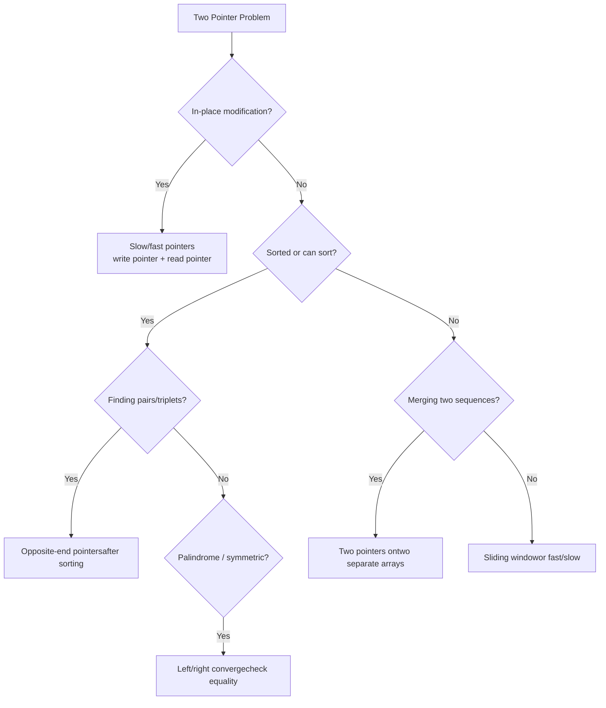

# Two Pointers — Pattern Notes

## Core Intuition

Two pointers eliminate the need for nested loops by maintaining two indices that move toward each other or in the same direction. The key is identifying **what invariant the pointers maintain**.

- **Opposite-end:** Left and right converge. Used when array is sorted or you need pairs summing to target.
- **Slow/fast (same direction):** One pointer reads, one writes. Used for in-place modification.
- **Sort + two pointers:** Sort first to enable the opposite-end technique for k-sum problems.

---

## Decision Flowchart

---

## Per-Problem Notes

### 1. Reverse String — LC 344 | Easy
- **Key insight:** Swap `s[left]` and `s[right]`, move pointers inward. In-place.
- **Tricky:** Nothing — pure two-pointer warm-up.
- **Common mistakes:** Using extra space (reversing into new array).
- **Time:** O(n) | **Space:** O(1)

### 2. Valid Palindrome — LC 125 | Easy
- **Key insight:** Skip non-alphanumeric chars. Compare lowercased chars from both ends.
- **Tricky:** Use `isalnum()` to filter. Don't preprocess into new string (O(n) space).
- **Common mistakes:** Not handling non-alphanumeric chars. Case sensitivity.
- **Time:** O(n) | **Space:** O(1)

### 3. Valid Palindrome II — LC 680 | Easy
- **Key insight:** On first mismatch, try skipping left char OR right char. Check if either remaining substring is a palindrome.
- **Tricky:** Only one deletion allowed. Helper function `isPalin(s, l, r)` avoids string slicing.
- **Common mistakes:** Trying to skip greedily without checking both options. Using string slicing (O(n) space per call).
- **Time:** O(n) | **Space:** O(1)

### 4. Merge Strings Alternately — LC 1768 | Easy
- **Key insight:** Two pointers on two strings, append alternately. Append remainder of longer string.
- **Tricky:** Handle different lengths — one pointer may exhaust before the other.
- **Common mistakes:** Not appending the remaining characters of the longer string.
- **Time:** O(n + m) | **Space:** O(n + m)

### 5. Merge Sorted Array — LC 88 | Easy
- **Key insight:** Merge from the back. Three pointers: end of nums1, end of nums2, end of merged array. Avoids shifting.
- **Tricky:** Fill from right to left — no need for extra space.
- **Common mistakes:** Merging from front (requires shifting). Forgetting to copy remaining nums2 elements.
- **Time:** O(n + m) | **Space:** O(1)

### 6. Remove Duplicates from Sorted Array — LC 26 | Easy
- **Key insight:** Slow pointer `k` marks next write position. Fast pointer scans. Write when `nums[fast] != nums[k-1]`.
- **Tricky:** Return `k` (count of unique elements), not the array.
- **Common mistakes:** Comparing with `nums[fast-1]` instead of `nums[k-1]` — wrong when duplicates are skipped.
- **Time:** O(n) | **Space:** O(1)

### 7. Two Sum II — LC 167 | Medium
- **Key insight:** Sorted array → opposite-end pointers. Sum too big → move right left. Sum too small → move left right.
- **Tricky:** 1-indexed output. Guaranteed exactly one solution.
- **Common mistakes:** Using hashmap (O(n) space) when O(1) is possible due to sorted input.
- **Time:** O(n) | **Space:** O(1)

### 8. 3Sum — LC 15 | Medium
- **Key insight:** Sort, fix one element, two-pointer on the rest. Skip duplicates at all three levels.
- **Tricky:** Three places to skip duplicates: outer loop, after moving left pointer, after moving right pointer.
- **Common mistakes:** Not skipping duplicates → duplicate triplets in output. Not sorting first.
- **Time:** O(n²) | **Space:** O(1) (excluding output)

### 9. 4Sum — LC 18 | Medium
- **Key insight:** Two nested loops + two-pointer. Sort first. Skip duplicates at all four levels.
- **Tricky:** Integer overflow for large values — use long in Java/C++. Python handles it natively.
- **Common mistakes:** Not skipping duplicates at the two outer loop levels. Overflow with large numbers.
- **Time:** O(n³) | **Space:** O(1) (excluding output)

### 10. Rotate Array — LC 189 | Medium
- **Key insight:** Three reverses: reverse all, reverse first k, reverse last n-k. In-place O(1) space.
- **Tricky:** `k = k % n` to handle k > n. Reversing in-place.
- **Common mistakes:** Not taking k mod n. Using extra array (O(n) space).
- **Time:** O(n) | **Space:** O(1)

### 11. Container With Most Water — LC 11 | Medium
- **Key insight:** Opposite-end pointers. Move the pointer with the shorter height (the shorter side is the bottleneck).
- **Tricky:** Always move the shorter side — moving the taller side can only decrease or maintain area.
- **Common mistakes:** Moving the taller side. Not updating max area at each step.
- **Time:** O(n) | **Space:** O(1)

### 12. Boats to Save People — LC 881 | Medium
- **Key insight:** Sort. Greedily pair heaviest with lightest if they fit. Otherwise heaviest goes alone.
- **Tricky:** Two pointers: lightest (left) and heaviest (right). Always move right. Move left only if paired.
- **Common mistakes:** Not sorting first. Moving both pointers when they don't fit together.
- **Time:** O(n log n) | **Space:** O(1)

### 13. Trapping Rain Water — LC 42 | Hard
- **Key insight:** Two-pointer approach: maintain `maxLeft` and `maxRight`. Water at position = `min(maxLeft, maxRight) - height[i]`. Move the side with smaller max.
- **Tricky:** Move the pointer with the smaller max height — that side's water level is determined.
- **Common mistakes:** Using O(n) extra arrays for left/right max (works but not optimal). Moving wrong pointer.
- **Time:** O(n) | **Space:** O(1)

---

## Edge Cases to Watch For

- **Empty or single-element array:** Most problems return 0 or trivially true.
- **All same elements:** 3Sum → only `[0,0,0]` if zeros, else no triplets. Remove duplicates → k=1.
- **k > n in rotate:** Always do `k = k % n` first.
- **Negative numbers in k-sum:** Sorting still works; just be careful with overflow in 4Sum.
- **Palindrome with all same chars:** Valid palindrome II — any deletion still palindrome.
- **Two Sum II — no solution:** Problem guarantees one, but in general handle no-solution case.
- **Trapping rain water — monotonically increasing/decreasing:** No water trapped.
- **3Sum/4Sum — target not zero:** Generalize the skip-duplicate logic carefully.
