# Two Pointers

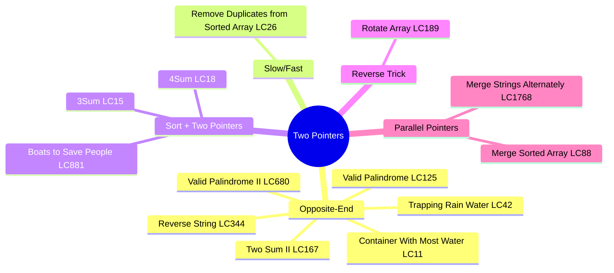

## Overview

This section covers 13 problems focusing on the two-pointer technique — using two indices to traverse data structures efficiently, often reducing O(n²) brute force to O(n).

## Problem List

| # | Problem | LC # | Difficulty | Key Techniques |
|---|---------|------|-----------|----------------|
| 1 | Reverse String | 344 | Easy | Opposite-end pointers |
| 2 | Valid Palindrome | 125 | Easy | Opposite-end pointers |
| 3 | Valid Palindrome II | 680 | Easy | Greedy skip |
| 4 | Merge Strings Alternately | 1768 | Easy | Parallel pointers |
| 5 | Merge Sorted Array | 88 | Easy | Three pointers (from end) |
| 6 | Remove Duplicates from Sorted Array | 26 | Easy | Slow/fast pointers |
| 7 | Two Sum II | 167 | Medium | Opposite-end pointers |
| 8 | 3Sum | 15 | Medium | Sort + two pointers |
| 9 | 4Sum | 18 | Medium | Sort + nested two pointers |
| 10 | Rotate Array | 189 | Medium | Reverse trick |
| 11 | Container With Most Water | 11 | Medium | Opposite-end pointers |
| 12 | Boats to Save People | 881 | Medium | Sort + opposite-end |
| 13 | Trapping Rain Water | 42 | Hard | Opposite-end pointers |

---

## Approach Flow Diagrams

### Two Pointer Categories

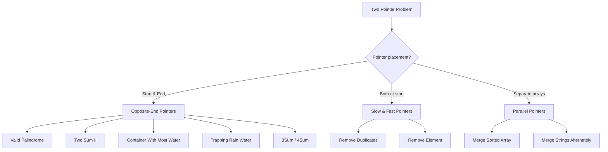

### Opposite-End Pointer Pattern

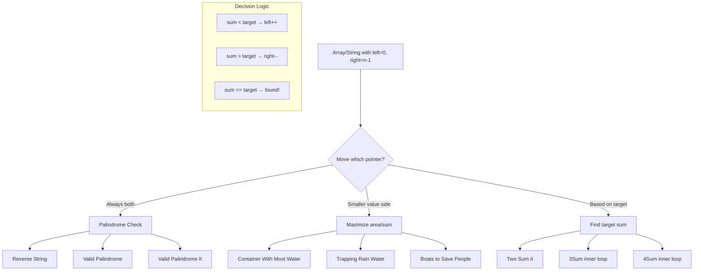

### Palindrome Verification Flow

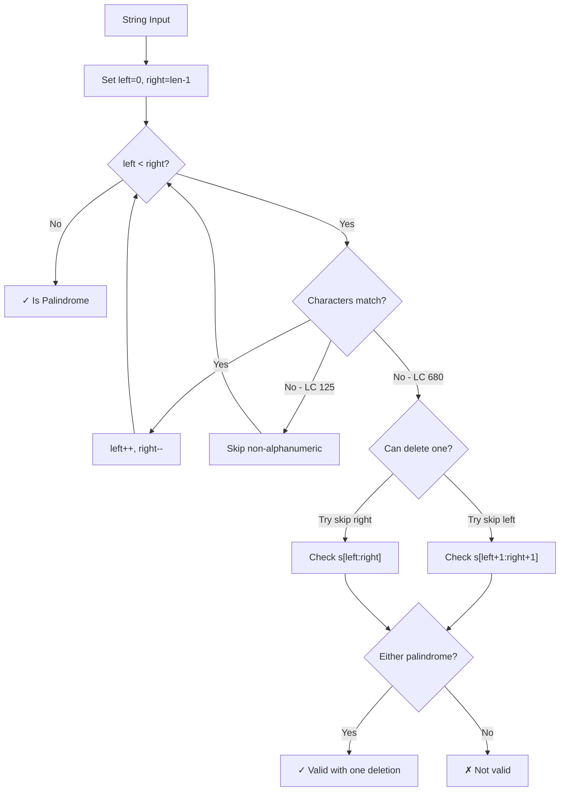

### Sort + Two Pointers (kSum Pattern)

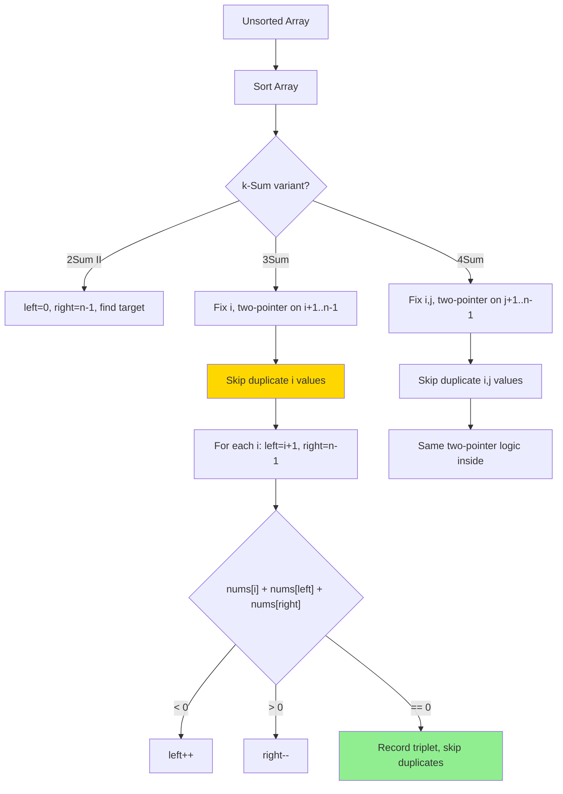

### Merge Pattern (From End)

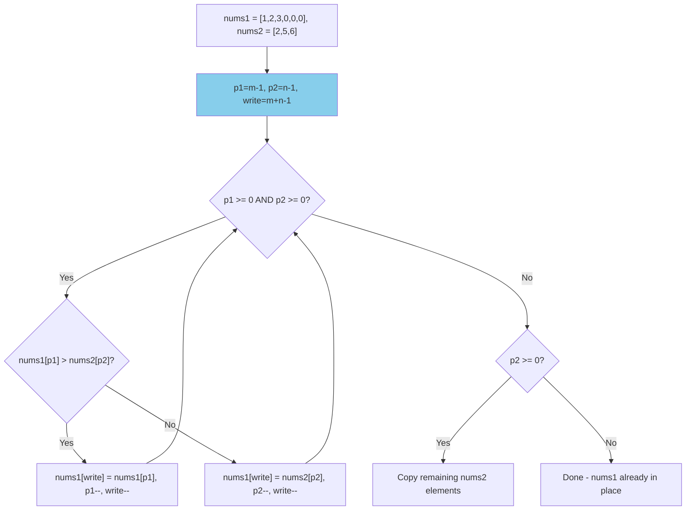

### Rotate Array — Reverse Trick

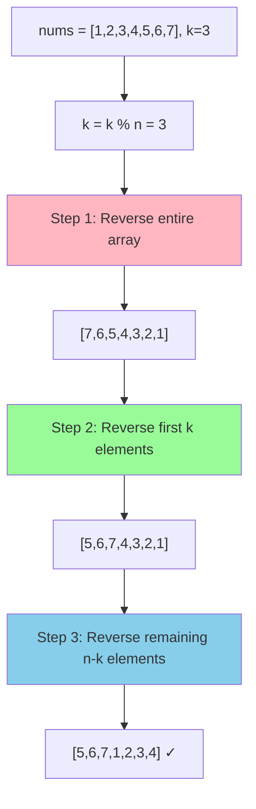

### Container With Most Water — Greedy Narrowing

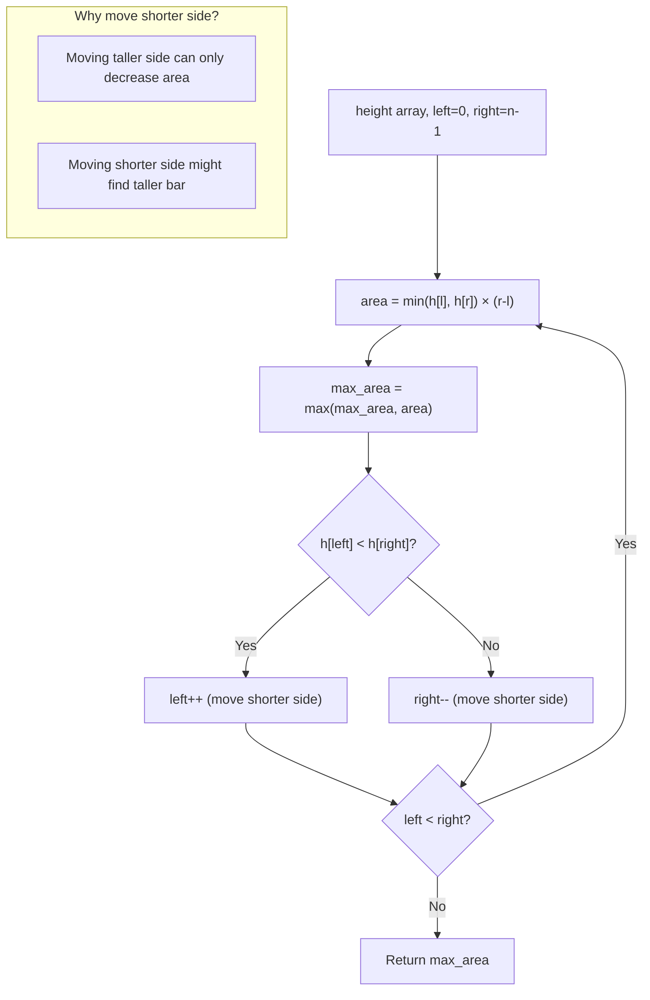

### Trapping Rain Water — Two Pointer Approach

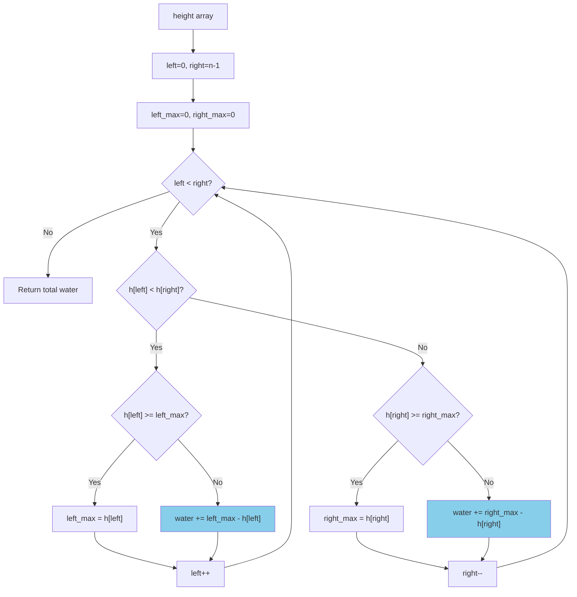

### Slow/Fast Pointer — Remove Duplicates

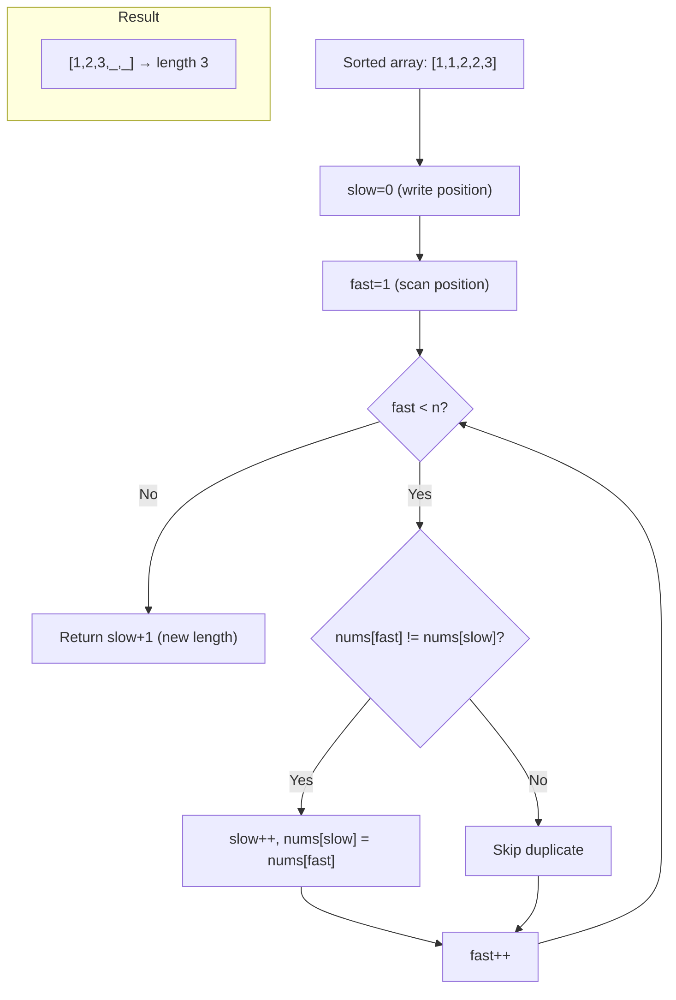

---

## Complexity Summary

| Problem | Time | Space | Pattern |
|---------|------|-------|---------|
| reverse_string | O(n) | O(1) | Opposite-end pointers |
| valid_palindrome | O(n) | O(1) | Opposite-end pointers |
| valid_palindrome_ii | O(n) | O(1) | Greedy skip |
| merge_strings_alternately | O(n) | O(n) | Parallel pointers |
| merge_sorted_array | O(m+n) | O(1) | Three pointers from end |
| remove_duplicates_from_sorted_array | O(n) | O(1) | Slow/fast pointers |
| two_sum_ii | O(n) | O(1) | Opposite-end pointers |
| 3sum | O(n²) | O(1) | Sort + two pointers |
| 4sum | O(n³) | O(1) | Sort + nested two pointers |
| rotate_array | O(n) | O(1) | Reverse trick |
| container_with_most_water | O(n) | O(1) | Opposite-end pointers |
| boats_to_save_people | O(n log n) | O(1) | Sort + opposite-end |
| trapping_rain_water | O(n) | O(1) | Opposite-end pointers |

---

## Study Order (Recommended)

```mermaid
flowchart LR
    subgraph W1["Week 1: Basics"]
        A1["reverse_string LC344"] --> A2["valid_palindrome LC125"]
        A2 --> A3["valid_palindrome_ii LC680"]
        A3 --> A4["merge_strings_alternately LC1768"]
    end

    subgraph W2["Week 2: Array Ops"]
        B1["remove_duplicates LC26"] --> B2["merge_sorted_array LC88"]
        B2 --> B3["rotate_array LC189"]
    end

    subgraph W3["Week 3: Target Sum"]
        C1["two_sum_ii LC167"] --> C2["three_sum LC15"]
        C2 --> C3["four_sum LC18"]
    end

    subgraph W4["Week 4: Advanced"]
        D1["container_most_water LC11"] --> D2["boats_to_save_people LC881"]
        D2 --> D3["trapping_rain_water LC42"]
    end

    A4 --> B1
    B3 --> C1
    C3 --> D1
```

---

## When to Use Two Pointers

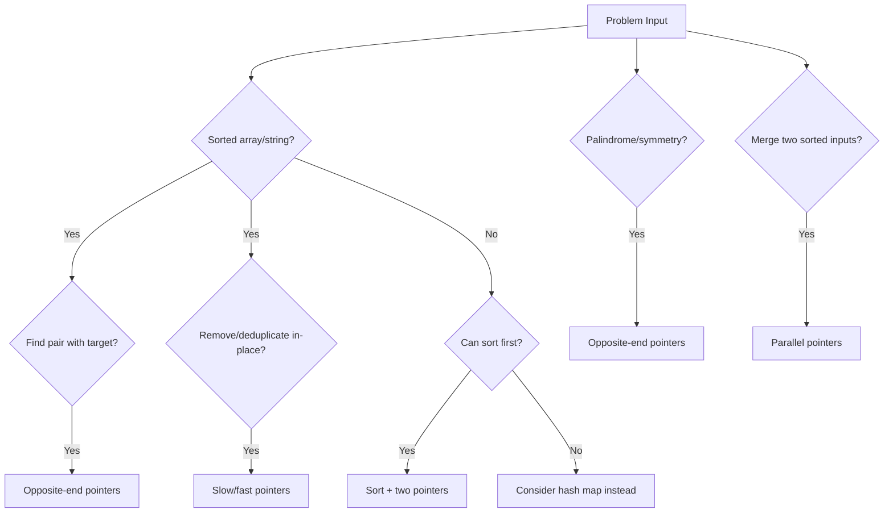
