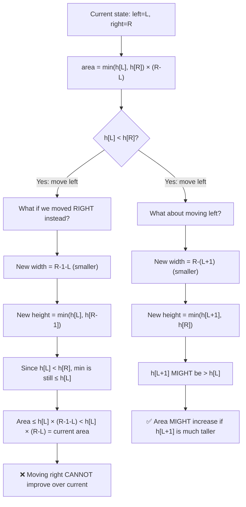

# LC 11: Container With Most Water — Proof of Greedy

## Problem
Find two lines that together with the x-axis form a container holding the most water.

---

## The Algorithm

```python
left, right = 0, n - 1
max_area = 0
while left < right:
    area = min(height[left], height[right]) * (right - left)
    max_area = max(max_area, area)
    if height[left] < height[right]:
        left += 1
    else:
        right -= 1
return max_area
```

---

## 🧮 Proof: Why Moving the Shorter Side is Optimal

### The Key Question
Why don't we miss the optimal pair by greedily moving pointers?



### Formal Proof

**Theorem:** The two-pointer algorithm considers every potentially optimal pair.

**Proof by contradiction:**

Suppose the optimal pair is `(i, j)` with `i < j`, and the algorithm skips it.

1. At some point, the algorithm has `left ≤ i` and `right ≥ j`.
2. The algorithm moves pointers inward. For it to skip `(i, j)`, either:
   - `left` passes `i` before `right` reaches `j`, OR
   - `right` passes `j` before `left` reaches `i`

3. Case: `right` moves past `j` (i.e., `right` was at `j` and moved left).
   - This happens when `height[left] ≥ height[j]` at that moment.
   - But then `area(left, j) ≥ area(i, j)` because `height[left] ≥ height[j]` and `left ≤ i < j`.
   - Wait — `left ≤ i` means width `j - left ≥ j - i`, and height is `min(h[left], h[j]) = h[j]` (since `h[left] ≥ h[j]`).
   - So `area(left, j) = h[j] × (j - left) ≥ h[j] × (j - i) ≥ area(i, j)`.
   - The algorithm already recorded this area (or better). **Contradiction.** ∎

### Intuition Summary

| Move | Width | Height | Area |
|------|-------|--------|------|
| Move taller side | Decreases | Can only stay same or decrease | **Guaranteed worse** |
| Move shorter side | Decreases | Might increase | **Might be better** |

The shorter side is the **bottleneck**. Moving it is the only way to potentially find a taller bottleneck.

### Complexity
- **Time:** O(n) — each pointer moves at most n times
- **Space:** O(1)
