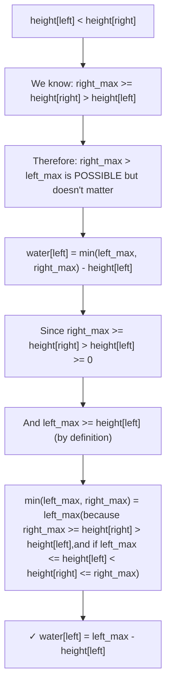

# LC 42: Trapping Rain Water — Proof of Approaches

## Problem
Given `n` non-negative integers representing an elevation map, compute how much water it can trap after raining.

---

## Approach 1: Brute Force — O(n²)

**Idea:** For each bar `i`, water above it = `min(max_left, max_right) - height[i]`

```
water[i] = min( max(height[0..i]), max(height[i..n-1]) ) - height[i]
```

**Why it works:** Water at any position is bounded by the shorter of the two tallest walls on either side.

---

## Approach 2: Prefix Arrays — O(n) time, O(n) space

Precompute `left_max[i]` and `right_max[i]`:
```
left_max[i]  = max(height[0], height[1], ..., height[i])
right_max[i] = max(height[i], height[i+1], ..., height[n-1])
water[i]     = min(left_max[i], right_max[i]) - height[i]
```

---

## Approach 3: Two Pointers — O(n) time, O(1) space ✅

```python
left, right = 0, n - 1
left_max, right_max = 0, 0
water = 0
while left < right:
    if height[left] < height[right]:
        left_max = max(left_max, height[left])
        water += left_max - height[left]
        left += 1
    else:
        right_max = max(right_max, height[right])
        water += right_max - height[right]
        right -= 1
```

### 🧮 Proof of Correctness

**Claim:** When `height[left] < height[right]`, the water at `left` is exactly `left_max - height[left]`.

**Proof:**



**Key Invariant:**
- When we process `left`: `right_max >= height[right] > height[left]`
- So `min(left_max, right_max) = left_max` (the left side is the bottleneck)
- We don't need to know the exact `right_max` — we just know it's NOT the limiting factor

**Symmetrically:** When `height[right] <= height[left]`, `left_max` is guaranteed ≥ `height[left]` ≥ `height[right]`, so `right_max` is the bottleneck.

### Walkthrough

```
height = [0, 1, 0, 2, 1, 0, 1, 3, 2, 1, 2, 1]

Step 1: left=0, right=11, h[0]=0 < h[11]=1
  left_max=0, water += 0-0 = 0, left=1

Step 2: left=1, right=11, h[1]=1 >= h[11]=1
  right_max=1, water += 1-1 = 0, right=10

Step 3: left=1, right=10, h[1]=1 < h[10]=2
  left_max=1, water += 1-1 = 0, left=2

Step 4: left=2, right=10, h[2]=0 < h[10]=2
  left_max=1, water += 1-0 = 1, left=3
  ...
Final: water = 6 ✓
```

### Complexity
- **Time:** O(n) — each pointer moves at most n times
- **Space:** O(1) — only 4 variables
