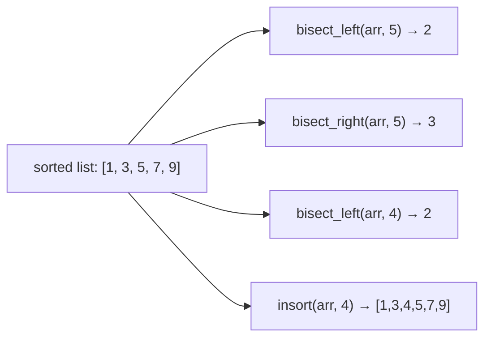
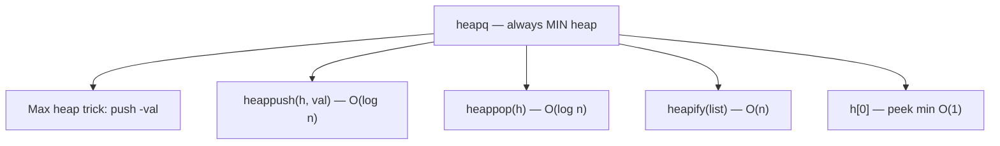
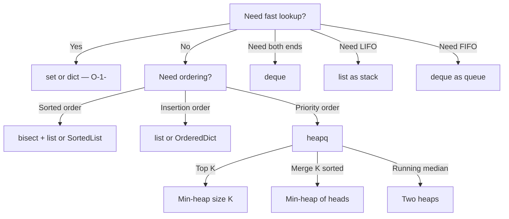
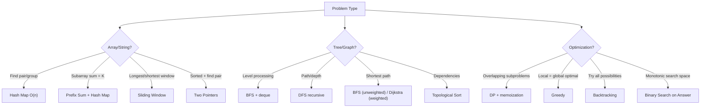

# Python Utilities for DSA

> Quick reference for Python built-ins, standard library modules, and patterns that save time in interviews.

---

## 📦 Essential Imports Cheat Sheet

```python
from typing import List, Optional, Dict, Tuple, Set
from collections import deque, defaultdict, Counter, OrderedDict
from heapq import heappush, heappop, heapify, nlargest, nsmallest
from bisect import bisect_left, bisect_right, insort
from functools import lru_cache, reduce
from itertools import accumulate, combinations, permutations, product
from math import gcd, lcm, inf, ceil, floor, sqrt, log2
from sortedcontainers import SortedList  # pip install, not always available
import string  # string.ascii_lowercase, string.digits
```

---

## 🔍 `bisect` — Binary Search on Sorted Lists



```python
from bisect import bisect_left, bisect_right, insort

arr = [1, 3, 5, 7, 9]

# Find insertion point (leftmost position)
bisect_left(arr, 5)    # 2 — index OF the element
bisect_left(arr, 4)    # 2 — where 4 would go

# Find insertion point (rightmost position)
bisect_right(arr, 5)   # 3 — index AFTER the element

# Insert while maintaining sort order
insort(arr, 4)         # arr = [1, 3, 4, 5, 7, 9]

# --- USE CASES ---

# 1. Check if element exists in sorted array
def binary_search(arr, target):
    i = bisect_left(arr, target)
    return i < len(arr) and arr[i] == target

# 2. Count elements in range [lo, hi]
def count_in_range(arr, lo, hi):
    return bisect_right(arr, hi) - bisect_left(arr, lo)

# 3. LIS in O(n log n)
def length_of_lis(nums):
    tails = []
    for num in nums:
        pos = bisect_left(tails, num)
        if pos == len(tails):
            tails.append(num)
        else:
            tails[pos] = num
    return len(tails)

# 4. Floor/Ceiling in sorted array
def floor_val(arr, target):
    i = bisect_right(arr, target) - 1
    return arr[i] if i >= 0 else None

def ceil_val(arr, target):
    i = bisect_left(arr, target)
    return arr[i] if i < len(arr) else None
```

---

## 📚 `collections` — Data Structures

### `defaultdict` — Auto-initializing dictionary

```python
from collections import defaultdict

# Graph adjacency list
graph = defaultdict(list)
graph[0].append(1)  # No KeyError!

# Grouping
groups = defaultdict(list)
for word in words:
    groups[tuple(sorted(word))].append(word)

# Counting (alternative to Counter)
count = defaultdict(int)
for x in arr:
    count[x] += 1
```

### `Counter` — Frequency counting

```python
from collections import Counter

arr = [1, 2, 2, 3, 3, 3]
c = Counter(arr)           # Counter({3: 3, 2: 2, 1: 1})
c.most_common(2)           # [(3, 3), (2, 2)]
c['new_key']               # 0 (no KeyError)
c.update([3, 3])           # adds to existing counts
c.subtract([3])            # subtracts from counts

# Check if s2 contains permutation of s1
Counter(s2_window) == Counter(s1)

# Check anagram
Counter(s) == Counter(t)

# Intersection (min of each)
Counter("aab") & Counter("ab")  # Counter({'a': 1, 'b': 1})
```

### `deque` — Double-ended queue (O(1) both ends)

```python
from collections import deque

q = deque()
q.append(1)        # right end
q.appendleft(2)    # left end
q.pop()            # right end
q.popleft()        # left end — THIS IS WHY deque > list for BFS

# BFS template
queue = deque([start])
while queue:
    node = queue.popleft()  # O(1) vs list.pop(0) which is O(n)!
    for neighbor in graph[node]:
        queue.append(neighbor)

# Sliding window maximum (monotonic deque)
dq = deque()  # stores indices
for i, num in enumerate(nums):
    while dq and nums[dq[-1]] <= num:
        dq.pop()
    dq.append(i)
    if dq[0] <= i - k:
        dq.popleft()

# Fixed-size window
dq = deque(maxlen=k)  # auto-pops from left when full
```

### `OrderedDict` — Dict preserving insertion order (LRU Cache)

```python
from collections import OrderedDict

class LRUCache:
    def __init__(self, capacity):
        self.cache = OrderedDict()
        self.cap = capacity

    def get(self, key):
        if key not in self.cache:
            return -1
        self.cache.move_to_end(key)  # Mark as recently used
        return self.cache[key]

    def put(self, key, value):
        if key in self.cache:
            self.cache.move_to_end(key)
        self.cache[key] = value
        if len(self.cache) > self.cap:
            self.cache.popitem(last=False)  # Remove LRU (first item)
```

---

## ⏫ `heapq` — Min-Heap (Priority Queue)



```python
import heapq

# Min-heap
h = []
heapq.heappush(h, 3)
heapq.heappush(h, 1)
heapq.heappush(h, 2)
heapq.heappop(h)       # 1 (smallest)

# Max-heap (negate values)
max_h = []
heapq.heappush(max_h, -3)
heapq.heappush(max_h, -1)
-heapq.heappop(max_h)  # 3 (largest)

# Heapify existing list — O(n)
arr = [5, 3, 8, 1]
heapq.heapify(arr)     # arr is now a valid min-heap

# Top K elements
heapq.nlargest(3, arr)   # 3 largest
heapq.nsmallest(3, arr)  # 3 smallest

# Custom comparison (use tuples)
# Priority queue with (priority, item)
heapq.heappush(h, (distance, node))
heapq.heappush(h, (-freq, word))  # max by freq, then min by word

# Merge K sorted lists
merged = list(heapq.merge([1,4,7], [2,5,8], [3,6,9]))
```

---

## 🔄 `itertools` — Combinatorial Utilities

```python
from itertools import accumulate, combinations, permutations, product, chain

# Prefix sums
list(accumulate([1, 2, 3, 4]))        # [1, 3, 6, 10]
list(accumulate([1, 2, 3], initial=0)) # [0, 1, 3, 6]

# All combinations of size k
list(combinations([1,2,3], 2))  # [(1,2), (1,3), (2,3)]

# All permutations
list(permutations([1,2,3]))     # all 6 orderings

# Cartesian product (nested loops)
list(product([0,1], repeat=3))  # all 3-bit binary numbers

# Flatten nested lists
list(chain.from_iterable([[1,2],[3,4]]))  # [1, 2, 3, 4]
```

---

## 🧮 `functools` — Memoization & Reduction

```python
from functools import lru_cache, cache, reduce

# Memoization for recursive DP
@lru_cache(maxsize=None)  # or @cache in Python 3.9+
def fib(n):
    if n <= 1:
        return n
    return fib(n-1) + fib(n-2)

# IMPORTANT: lru_cache only works with hashable args
# For lists, convert to tuple: dp(tuple(nums), i)

# Reduce — fold a sequence
reduce(lambda a, b: a * b, [1, 2, 3, 4])  # 24
reduce(gcd, [12, 18, 24])                  # 6
```

---

## 🔢 `math` — Numeric Utilities

```python
from math import gcd, lcm, inf, ceil, floor, sqrt, log2, comb, factorial

gcd(12, 18)          # 6
lcm(4, 6)            # 12 (Python 3.9+)
ceil(7 / 3)          # 3
floor(7 / 3)         # 2
sqrt(16)             # 4.0
log2(8)              # 3.0
comb(5, 2)           # 10 (5 choose 2)
factorial(5)         # 120

# Integer ceiling division (no import needed)
-(-a // b)           # ceil(a/b) for positive a, b
(a + b - 1) // b    # same thing

# Check if perfect square
def is_perfect_square(n):
    r = int(sqrt(n))
    return r * r == n

# GCD of a list
from functools import reduce
reduce(gcd, [12, 18, 24])  # 6
```

---

## 🐍 Python-Specific Tricks for DSA

### Sorting

```python
# Sort by custom key
intervals.sort(key=lambda x: x[1])          # sort by end time
words.sort(key=lambda w: (-len(w), w))       # longest first, then alphabetical

# Sort with multiple criteria
students.sort(key=lambda s: (s.grade, -s.age))  # grade asc, age desc

# Stable sort — equal elements keep original order
# Python's sort is STABLE (TimSort)
```

### String Operations

```python
# Character checks
c.isalpha()      # letter?
c.isdigit()      # digit?
c.isalnum()      # letter or digit?
c.lower()        # lowercase version

# Alphabet index
ord('a')         # 97
ord('z') - ord('a')  # 25
chr(97)          # 'a'

# Build string efficiently
parts = []
parts.append("hello")
parts.append("world")
result = "".join(parts)  # O(n) total vs += which is O(n²)

# Count characters
s.count('a')     # occurrences of 'a'

# String to list of chars and back
chars = list("hello")
chars.reverse()
"".join(chars)   # "olleh"
```

### List/Array Tricks

```python
# Initialize 2D array (CORRECT way)
grid = [[0] * cols for _ in range(rows)]
# WRONG: [[0]*cols]*rows — all rows share same reference!

# Flatten 2D to 1D index
idx = row * cols + col
row, col = divmod(idx, cols)

# Zip for parallel iteration
for a, b in zip(list1, list2):
    pass

# Enumerate with start index
for i, val in enumerate(arr, start=1):
    pass

# List comprehension with condition
evens = [x for x in arr if x % 2 == 0]

# Unpacking
first, *middle, last = [1, 2, 3, 4, 5]
# first=1, middle=[2,3,4], last=5
```

### Set Operations

```python
a = {1, 2, 3}
b = {2, 3, 4}

a | b    # union: {1, 2, 3, 4}
a & b    # intersection: {2, 3}
a - b    # difference: {1}
a ^ b    # symmetric difference: {1, 4}

# Frozen set (hashable, can be dict key or set element)
frozenset([1, 2, 3])
```

### Infinity and Boundaries

```python
float('inf')     # positive infinity
float('-inf')    # negative infinity
# Or:
from math import inf

# Integer limits (Python has arbitrary precision, but for 32-bit problems)
INT_MAX = 2**31 - 1   # 2147483647
INT_MIN = -2**31      # -2147483648
```

### Bit Manipulation

```python
# Basic operations
x & y        # AND
x | y        # OR
x ^ y        # XOR
~x           # NOT (bitwise complement)
x << n       # left shift (multiply by 2^n)
x >> n       # right shift (divide by 2^n)

# Common tricks
x & (x - 1)         # remove lowest set bit
x & (-x)            # isolate lowest set bit
bin(x).count('1')   # count set bits
x.bit_length()      # number of bits needed

# Check if power of 2
x > 0 and x & (x - 1) == 0

# Get ith bit
(x >> i) & 1

# Set ith bit
x | (1 << i)

# Clear ith bit
x & ~(1 << i)

# Toggle ith bit
x ^ (1 << i)
```

---

## 🏗️ Common Data Structure Implementations

### Union-Find (Disjoint Set)

```python
class UnionFind:
    def __init__(self, n):
        self.parent = list(range(n))
        self.rank = [0] * n
        self.components = n

    def find(self, x):
        if self.parent[x] != x:
            self.parent[x] = self.find(self.parent[x])  # path compression
        return self.parent[x]

    def union(self, x, y):
        px, py = self.find(x), self.find(y)
        if px == py:
            return False
        if self.rank[px] < self.rank[py]:
            px, py = py, px
        self.parent[py] = px
        if self.rank[px] == self.rank[py]:
            self.rank[px] += 1
        self.components -= 1
        return True
```

### Trie (Prefix Tree)

```python
class TrieNode:
    def __init__(self):
        self.children = {}
        self.is_end = False

class Trie:
    def __init__(self):
        self.root = TrieNode()

    def insert(self, word):
        node = self.root
        for c in word:
            if c not in node.children:
                node.children[c] = TrieNode()
            node = node.children[c]
        node.is_end = True

    def search(self, word):
        node = self._find(word)
        return node is not None and node.is_end

    def starts_with(self, prefix):
        return self._find(prefix) is not None

    def _find(self, s):
        node = self.root
        for c in s:
            if c not in node.children:
                return None
            node = node.children[c]
        return node
```

### Segment Tree (Range Query)

```python
class SegTree:
    def __init__(self, nums):
        self.n = len(nums)
        self.tree = [0] * (2 * self.n)
        for i in range(self.n):
            self.tree[self.n + i] = nums[i]
        for i in range(self.n - 1, 0, -1):
            self.tree[i] = self.tree[2*i] + self.tree[2*i+1]

    def update(self, i, val):
        i += self.n
        self.tree[i] = val
        while i > 1:
            i //= 2
            self.tree[i] = self.tree[2*i] + self.tree[2*i+1]

    def query(self, l, r):  # sum of [l, r)
        res = 0
        l += self.n
        r += self.n
        while l < r:
            if l & 1:
                res += self.tree[l]
                l += 1
            if r & 1:
                r -= 1
                res += self.tree[r]
            l //= 2
            r //= 2
        return res
```

---

## ⚡ Complexity Quick Reference

| Operation | list | deque | set | dict | heapq |
|-----------|------|-------|-----|------|-------|
| Append/Push | O(1) | O(1) | — | — | O(log n) |
| Pop end | O(1) | O(1) | — | — | O(log n) |
| Pop front | **O(n)** | O(1) | — | — | — |
| Search | O(n) | O(n) | O(1) | O(1) | O(n) |
| Insert at i | O(n) | O(n) | O(1) | O(1) | — |
| Sort | O(n log n) | — | — | — | — |
| Min/Max | O(n) | O(n) | O(n) | O(n) | O(1)/O(n) |

---

## 🎯 When to Use What



---

## 🔤 `string` Module — Character Sets

```python
import string

string.ascii_lowercase   # 'abcdefghijklmnopqrstuvwxyz'
string.ascii_uppercase   # 'ABCDEFGHIJKLMNOPQRSTUVWXYZ'
string.ascii_letters     # lower + upper
string.digits            # '0123456789'
string.punctuation       # '!"#$%&\'()*+,-./:;<=>?@[\\]^_`{|}~'

# Build alphabet index map
char_to_idx = {c: i for i, c in enumerate(string.ascii_lowercase)}
# {'a': 0, 'b': 1, ..., 'z': 25}

# Check character type
'a'.isalpha()    # True
'1'.isdigit()    # True
'a'.isalnum()    # True
' '.isspace()    # True
'A'.isupper()    # True
'a'.islower()    # True
```

---

## 🌳 Tree & Graph Templates

### TreeNode + Build Helper
```python
from collections import deque

class TreeNode:
    def __init__(self, val=0, left=None, right=None):
        self.val = val; self.left = left; self.right = right

def build_tree(vals):
    """Build tree from level-order list (None = missing node)"""
    if not vals: return None
    root = TreeNode(vals[0])
    q = deque([root]); i = 1
    while q and i < len(vals):
        node = q.popleft()
        if i < len(vals) and vals[i] is not None:
            node.left = TreeNode(vals[i]); q.append(node.left)
        i += 1
        if i < len(vals) and vals[i] is not None:
            node.right = TreeNode(vals[i]); q.append(node.right)
        i += 1
    return root
```

### Graph Templates
```python
# Adjacency list (undirected)
graph = defaultdict(list)
for u, v in edges:
    graph[u].append(v)
    graph[v].append(u)

# Grid BFS (4-directional)
DIRS = [(0,1),(0,-1),(1,0),(-1,0)]
def bfs_grid(grid, sr, sc):
    rows, cols = len(grid), len(grid[0])
    queue = deque([(sr, sc)])
    visited = {(sr, sc)}
    while queue:
        r, c = queue.popleft()
        for dr, dc in DIRS:
            nr, nc = r+dr, c+dc
            if 0<=nr<rows and 0<=nc<cols and (nr,nc) not in visited:
                visited.add((nr,nc)); queue.append((nr,nc))

# Union-Find (path compression + union by rank)
class UnionFind:
    def __init__(self, n):
        self.parent = list(range(n)); self.rank = [0]*n; self.components = n
    def find(self, x):
        if self.parent[x] != x: self.parent[x] = self.find(self.parent[x])
        return self.parent[x]
    def union(self, x, y):
        px, py = self.find(x), self.find(y)
        if px == py: return False
        if self.rank[px] < self.rank[py]: px, py = py, px
        self.parent[py] = px
        if self.rank[px] == self.rank[py]: self.rank[px] += 1
        self.components -= 1; return True
```

---

## 🔑 Common Interview Patterns — Quick Reference



---

## 📐 Modular Arithmetic (for large number problems)

```python
MOD = 10**9 + 7

# Fast modular exponentiation
def pow_mod(base, exp, mod):
    result = 1
    base %= mod
    while exp > 0:
        if exp & 1: result = result * base % mod
        base = base * base % mod
        exp >>= 1
    return result

# Python built-in (same thing)
pow(base, exp, mod)  # O(log exp)

# Modular inverse (when mod is prime)
inv = pow(a, MOD - 2, MOD)  # Fermat's little theorem

# Combinations mod p
from math import comb
comb(n, k) % MOD  # Only works for small n, k
```
